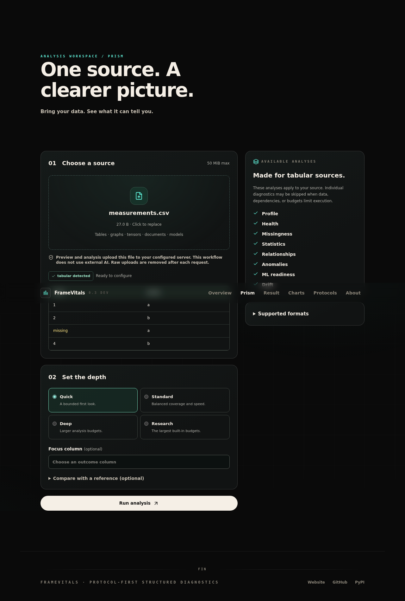
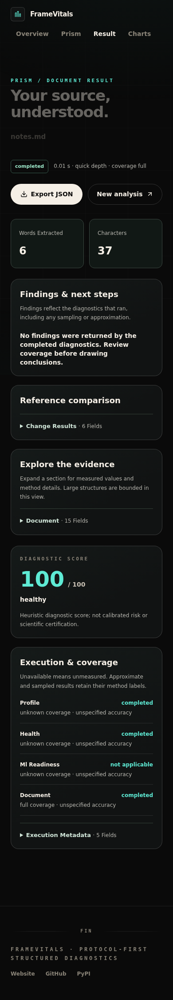

# Phase 1 engineering audit

Baseline `009b2e7fb40ec707198cbbf93597b074d442d434`; implementation branch `work/framevitals-sol-platform`; review: https://github.com/parthdongre/FrameVitals/pull/66.

Scope: architecture, input routes, installed package, CLI/TUI, source engines, result presentation, React application, parser boundaries, sessions, CI and tests. This audit does not certify scientific validity. The companion module map inventories every Python source module and its direct consumers from the actual source AST.

## Findings and changes

| Area / owner | Actual responsibility and callers | Confirmed finding | Resolution / remaining work |
| --- | --- | --- | --- |
| `__init__`, `api`, `protocols` | Public APIs; CLI, browser, notebook consumers | Prism imported tabular/modeling stack before structured dispatch | Dispatch stays domain-specific; tabular imports deferred; capabilities and additive envelope exposed |
| `core/source`, `file_formats`, `capabilities` | Recognition and source operations; Python/CLI/TUI/HTTP | Web allowlist disagreed with terminal capabilities | Shared format list and applicability registry; parser availability reported without implicit installation |
| `sources`, `duckdb_source`, `streaming_pipeline`, `streaming_profile`, execution modules | Tabular adapters and bounded/exact profiling, planner and focused APIs | Mature source-aware path already exists; replacing with browser math would diverge | Reused unchanged; Parquet web loader wired; dependency-sensitive CSV row-metadata assertion corrected for both Arrow and core-only installations |
| `planning`, `planner`, `analysis_selector`, `execution_context`, `config` | Resource budgets and module selection | Per-mode skips were flattened in presentation | Envelope retains engine module status and mode; invalid structured depth now rejected |
| `analysis/*` | Independent graph/tensor/nested/model/document/relational engines | New domains absent from web; graph XML and Office parsing lacked common preflight | Structured web dispatch added; XML/archive guards; topology and singular-value payload additions only, no formula changes |
| `result`, `quality_results`, `snapshots`, `result_contract`, `serialization` | Mapping-compatible results, snapshots and JSON/HTTP/terminal serialization | JSON could emit NaN/Infinity; no consistent domain-independent status wrapper | Strict shared serializer and additive v1 envelope; missing/unknown/approximate semantics retained |
| `findings`, `core/beacons`, `quality_diagnostics`, `health_score` | Interpret analytical results and derive findings | Heuristic scores can look like calibrated guarantees | Browser/HTML explicitly label scores heuristic; calibration and domain-dependent severity deferred to Astra |
| `pipeline`, `analysis_api`, `focused`, `operations` | Canonical tabular execution, cleaning, contracts and drift | Legacy web did direct tabular-only work | Unified web uses Prism; legacy route retained under tests, not advertised as structured support |
| `acceleration`, `_native`, Rust core/PyO3 | Capability probing, native kernels and fallback | Default wheel must not require native toolchain | Pure wheel verified without native binary; native workspace and bridge separately built/tested |
| `loader`, `security`, `input_safety` | Upload paths, safe names, parser preflight | Restricted allowlist, raw path retention, no decompression limits | Generated storage names; shared suffixes; cleanup after unified requests and upload eviction; bounded archive/XML policy |
| `webapp`, root `app.py` | HTTP/session/cache/artifact orchestration | Flask app not shipped in wheel; cross-session result access; unbounded PDF threads | Installed `framevitals serve`, compatibility shim, session guards, bounded execution/report pool, JSON errors, no-store responses |
| `ai_insights`, `ai_agent`, agent tools | Optional provider-backed narratives and bounded registered tools | Provider configuration could trigger undisclosed external calls | Unified route disables AI; explicit consent required at HTTP boundary and in legacy AI controls; direct Python AI APIs remain explicit developer APIs |
| `reporting/*`, `frontend_api` | HTML/notebook/terminal and legacy dashboard projections | Missing scores could render as zero/blank | Strict JSON export and unavailable labels; legacy projection retained for compatibility |
| React `App`, router, stores | Navigation and latest result lifecycle | All pages eagerly imported; previous mock-data hook remained | Lazy page chunks; memory-only typed platform result; verified-unused mock hook/fixture and obsolete analyze hook removed |
| `AnalyzePage`, `PlatformReport` | Input → detection → applicability → configuration → evidence/export | Browser supported only tables, no source-aware report | Real server previews, reference comparison, source-specific metrics, bounded SVG/bars and progressive evidence |
| Existing report tabs and charts | Legacy detailed tabular result views | Large typed migration would risk unnecessary regressions | Retained; shared HTTP client and consent improved; no second analysis engine introduced |
| CI and release packaging | Python/platform/native checks, frontend build | No browser integration/accessibility workflow | Added platform HTTP and Chromium/axe checks; existing CI retained; no release/deployment action |

## Duplicated and unused responsibilities

`api.py` is a compatibility facade rather than a second engine. `__init__.py` contains thin lazy public wrappers. Root `app.py` now aliases the packaged web module, preserving existing imports and monkeypatch behavior. The old `frontend_api.py` projection and tabular report tabs are still used by compatibility routes; they were not deleted.

The old `useTelemetryQuery` hook had no consumers and returned a fabricated fixture after a delay. It and the fixture were removed after `git grep` verified their uses; shared types were moved to `data/telemetry.ts`. The old `useAnalyzeDatasetMutation` had no consumers after the unified page replacement and was removed. No mathematical engine or algorithm was removed.

## Validation and evidence

- Baseline: 518 passed, 15 optional skips, 1 stale metadata assertion failed.
- Expanded environment: native extension, ONNX, DuckDB, Polars and CPU PyTorch installed only for verification; full suite passed. Final counts and exact commands are in the handoff.
- Browser: real Flask + Vite + Chromium, actual multipart requests, tabular/nested/document/graph/tensor inputs, reference comparison, download and error paths. Automated axe scans cover the tested workspace/report main content; this is not a comprehensive WCAG certification.
- Screenshots captured and visually inspected at desktop and 390 px mobile widths. Details, charts and navigation remain bounded; no horizontal document overflow in the tested mobile report.
- Rust workspace tests, format check, Clippy and PyO3 build executed; pure wheel build/metadata and a separate clean wheel installation verified.

## Performance observations

The entry JS bundle fell from 447.70 kB (141.96 kB gzip) to approximately 382.77 kB (122.12 kB gzip). The large Highcharts chunk remains lazy. No new runtime chart library was introduced. Native-free tensor dispatch avoids importing the tabular/scikit-learn stack: representative 8×6 quick tensor dispatch observed about 12 ms / 32 MiB process peak RSS versus a baseline first dispatch about 785 ms / 211 MiB. These are directional environment observations, not controlled speedup claims; toolchain/dependency availability and process warm-up matter.

`benchmarks/platform_probe.py` supports reproducible fresh-process overhead checks; tracemalloc tracks Python allocations, not all native buffers. Scientific algorithm benchmarks remain Astra's responsibility.

## Open limitations

1. No account authentication or multi-process shared cache has been added. Server defaults to loopback; private deployment requires external authentication/TLS and a stable session key. Nothing was deployed.
2. Application parser/analysis budgets do not impose hard OS memory/time limits. Hostile multi-tenant inputs need worker/container isolation, particularly PDF decompression/extraction.
3. Legacy report/chart/cleaned artifacts require deployment retention policies. Unified requests delete raw inputs and produce no server artifacts, but process-crash cleanup is not guaranteed.
4. Browser supports file sources. In-memory PyTorch runtime/optimizer hooks and relational table mappings remain Python features; unsafe checkpoint upload is intentionally unavailable.
5. Graph/topology preview uses a bounded circular display; it is not a force-directed embedding or a claim about geometric relationships. Spectral values are existing engine outputs.
6. Underlying aggregate sampled/exact labels vary by engine. Unknown metadata stays unknown; Astra should improve granular provenance and validate score/severity assumptions.
7. Actual macOS/Windows terminal and Safari rendering were not executed here. Existing cross-platform CI remains available; local results are Linux/Chromium.
